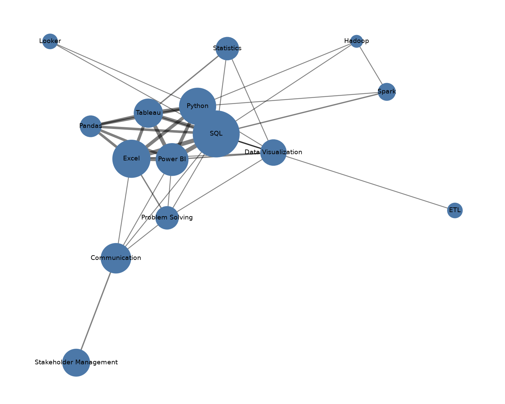

# Job Market Intelligence Pipeline

An automated pipeline that tracks Data Analyst and Business Analyst job postings in India and turns them into skill-demand insights. It runs every day in the cloud with no manual work.

**Live app:** https://job-market-pipeline-n4qyxxqdzzfsbtk5cckztg.streamlit.app/
## Screenshots

**Streamlit app**

**Power BI dashboard (skill demand page)**

The Power BI file is `dashboard/job_market_dashboard.pbix`. It has 5 pages: skill demand, locations, skill network, pipeline health and salary insights. It reads CSV files exported by the `scripts/export_*.py` scripts, so it is refreshed by re-running those scripts and clicking Refresh in Power BI. A live PostgreSQL connection failed on a certificate error, so I used CSV exports instead.

[Full dashboard as a PDF (all 5 pages)](dashboard/job_market_dashboard.pdf)

## What it does

- Pulls job postings daily from two sources (Adzuna API and Jooble API)
- Cleans the text, removes duplicates, standardizes city names and detects skills (SQL, Python, Power BI and more)
- Stores everything in a PostgreSQL database
- Shows skill demand and a searchable job list in a public Streamlit app
- Emails a weekly summary of top skills and hiring cities
- Builds a skill co-occurrence network showing which skills appear together

## Architecture

    Adzuna API + Jooble API
            |
    Python: fetch -> normalize -> clean -> dedupe -> skill extraction
            |
    Supabase PostgreSQL (postings, posting_skills, pipeline_runs)
            |
    +-------+----------------+------------------+
    |                        |                  |
    Streamlit app      Weekly email digest   Skill network (networkx) + Power BI

GitHub Actions runs the pipeline daily (8:00 AM IST) and the email digest every Monday.

## Tech stack

Python, pandas, requests, psycopg2, networkx, matplotlib, PostgreSQL (Supabase), GitHub Actions, Streamlit, Power BI

## Design decisions

- **Two job sources** so one API outage or gap does not stop the pipeline.
- **GitHub Actions** for scheduling: free, runs without my laptop, and keeps the pipeline code and schedule together.
- **Duplicate protection** on title + company + city, so repeated daily pulls never create duplicate rows.
- **Run log table** (`pipeline_runs`) records every run: jobs fetched, duplicates removed, new jobs loaded, time taken and status.
- **Read-only database login** for the public app, so the public link can never change or delete data.
- **Secrets in GitHub Secrets**, never in the code.

## Skill co-occurrence network

## Salary band analysis

Most postings have no salary, so I tested whether salary bands (Low / Mid / High, split into equal thirds) can be predicted from job type, city, seniority keywords in the title, and detected skills.

- **Data:** 53 postings with an employer-posted annual salary of at least 100,000 INR. Entries below that were removed as likely typos or monthly figures.
- **Model:** logistic regression, evaluated with repeated 5-fold cross-validation.
- **Result:** 43% accuracy (+/- 12%) against 38% for always guessing the most common band. The gap is within the noise, so there is no reliable signal yet.
- **Weak spot:** the model catches Low and Mid roles better than High ones (2 of 15 High roles found).
- **Decision:** I did not use the model to fill in missing salaries, because that would present guesses as data. The test will be re-run as the pipeline collects more salary data (`scripts/salary_model.py`).

## Known limitations

- Both APIs return only a short snippet of each job description, so skill detection misses skills mentioned later in the full posting. Real skill percentages are higher than shown.
- Most Indian postings have no salary field, so salary analysis is limited.
- Location is sometimes only "India" in the source data, so those jobs are marked Unspecified.

## Project structure

    scripts/    fetch, clean, dedupe, load, digest and analysis scripts
    sql/        table definitions and views
    docs/       skill network image
    app.py      Streamlit app
    .github/    GitHub Actions workflows (daily pipeline, weekly digest)

## Author

Riya Vaishya